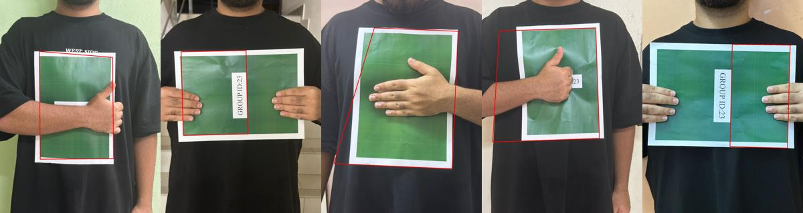

# A4 Paper Detection with A* Search

Finds the four corners of an A4 sheet in a photo, even when a hand or arm partly covers it. Edges come from Canny and the Hough transform, line intersections become candidate corners, and the four corners are chosen by searching that space with **BFS**, **A\* with an admissible, consistent heuristic (h1)** and **A\* with a confidence-based heuristic (h2)**.

Section B of the COMP1032 Fundamentals of AI coursework. I designed and implemented this section myself; the photo dataset was collected by my coursework group.



*The red outline is the best rectangle found on each of my five photos. Only the first closely matches the whole sheet; see [Results](#results).*

## How it works

1. **Preprocess.** Resize to 2100×2800, convert to greyscale, apply a 7×7 Gaussian blur, Canny edge detection and dilation.
2. **Find lines.** The scikit-image Hough transform finds up to 25 dominant lines, keeping those roughly parallel or perpendicular to the main direction.
3. **Find candidate corners.** Intersections of near-perpendicular line pairs, with nearby points merged.
4. **Search.** Choose 4 corners from the candidates:

| | Definition |
| --- | --- |
| State | Ordered list of 0 to 4 chosen corners |
| Initial state | Empty list |
| Successors | Add one corner that lies on a Hough line through the last corner (within 88 px), keeps interior angles between 75° and 105°, and for the fourth corner passes side-length, aspect-ratio and closing checks |
| Goal | 4 corners spanning at least 25% of the image in each direction, with a `likelihoodA4` score of at least 0.20 |
| Path cost | 1 per corner, plus an angle penalty of \|angle − 90\| / 15 |
| h1 | 4 − k (corners still needed): admissible and consistent |
| h2 | (4 − k) × (1 − confidence), using angle and edge-density confidence: admissible but not consistent |

5. **Score and draw.** The best rectangle is scored with `likelihoodA4` (edge alignment plus an A4 aspect-ratio prior), drawn on the image and saved to a CSV with its corners and pixels-per-cm ratio.

The full design, proofs and analysis are in [`docs/REPORT.md`](docs/REPORT.md).

## Results

Tested on 30 photos (5 each from six people). Only my own 5 photos are included in this repository.

**Search efficiency** (mean over the 25 images where a rectangle was returned):

| Method | Nodes expanded | Time per image | Score |
| --- | --- | --- | --- |
| BFS (h = 0) | 678 | 11.9 s | 0.474 |
| A\* h1 | **225** | **3.2 s** | 0.474 |
| A\* h2 | 568 | 10.7 s | 0.474 |

A\* with h1 expanded about a third as many nodes as BFS and ran about 3.7 times faster, while reaching the same score on every image. h2 gave little gain over BFS.

**Detection quality:** a rectangle was returned for 25 of 30 images (83%), but a visual check of the outlines shows that only about 10 of them closely match the whole sheet. The others cover part of the sheet (often the half on one side of an arm), or are shifted or skewed. The highest-scoring image in the whole dataset (my photo 5, score 0.613) is one of the partial ones, which shows that the score function does not reliably tell a correct outline from a partial one.

The results for my photos are in [`results/`](results/), and the per-image breakdown for all 30 photos (anonymised) is in the report.

## Run it

```bash
pip install -r requirements.txt
jupyter notebook a4_detection.ipynb
```

Then run all cells. The notebook processes every image in `images/` and writes the CSV and overlay images to `results/`. To try your own photos, add them to `images/`. Each image takes from a few seconds to about a minute, since all three search methods run on it.

## Project structure

```text
.
├── a4_detection.ipynb   # detection pipeline, search, batch run and results
├── images/              # input photos (my 5)
├── results/             # overlays + a4_detection_results.csv
├── docs/
│   ├── REPORT.md        # problem formulation, proofs, analysis
│   └── preview.jpg
└── requirements.txt
```

## Limitations and next steps

- **Partial outlines.** An arm across the sheet creates strong edges that the search can mistake for the sheet's border. A score that rewards covering the bright paper region, or penalises outlines that cross strong interior edges, would help.
- **No ground truth.** Results are judged by the score and by eye. Hand-labelled corner positions would allow a proper accuracy measure such as corner error or IoU.
- **Fixed parameters.** The Canny, Hough and angle thresholds are hand-tuned. Bent paper, steep camera angles and cluttered backgrounds caused the 5 failures.
- **Speed.** Python loops over candidate points are slow on images with many candidates.

## Tools

Python, OpenCV, NumPy, scikit-image, Matplotlib, Jupyter.
